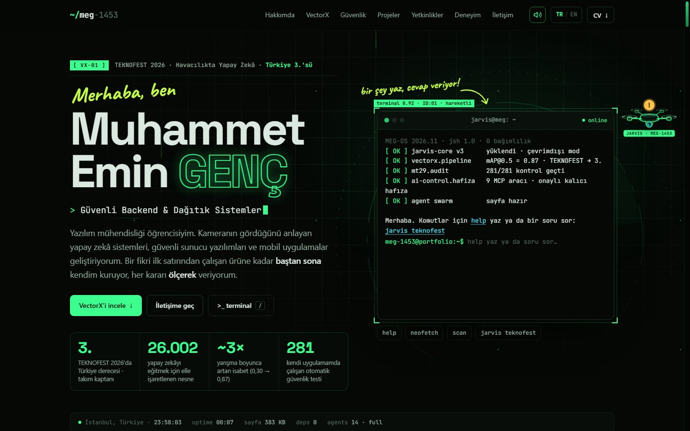
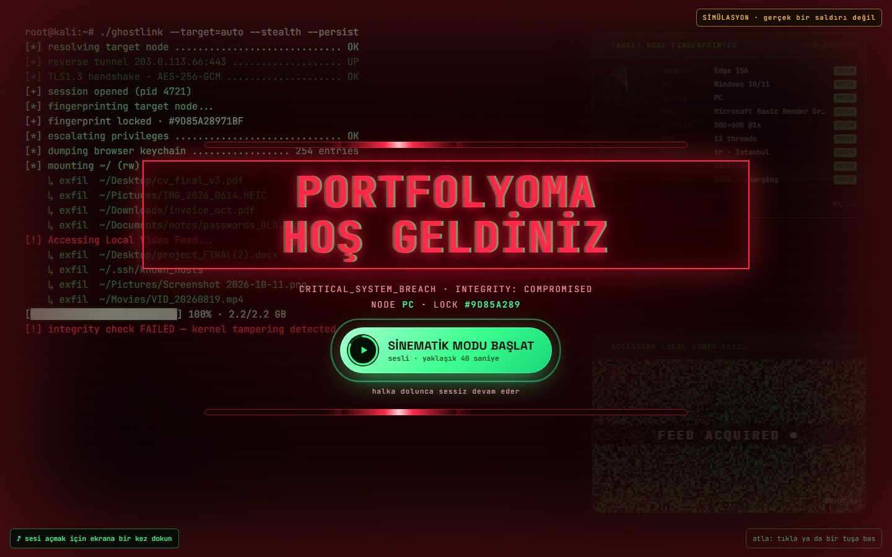
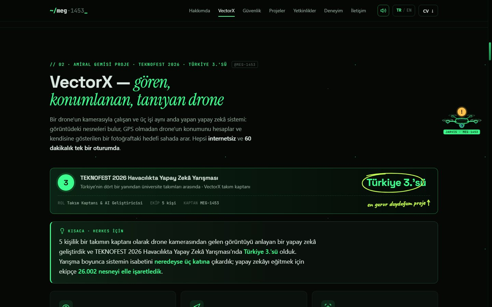
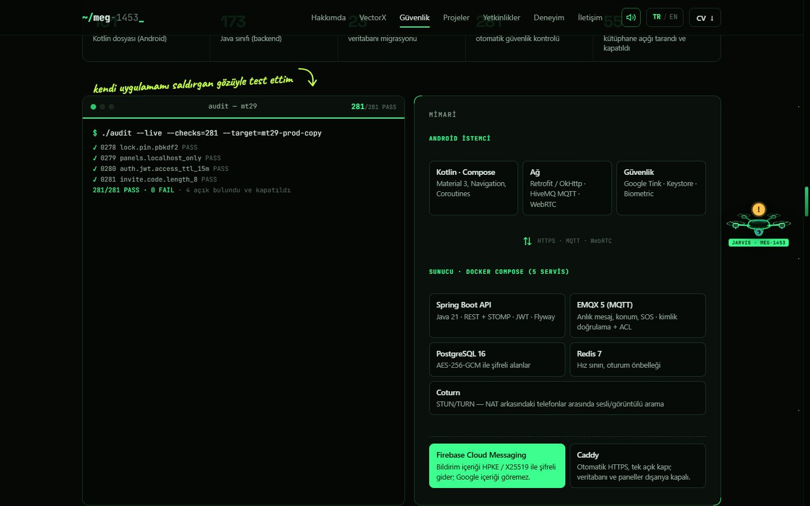
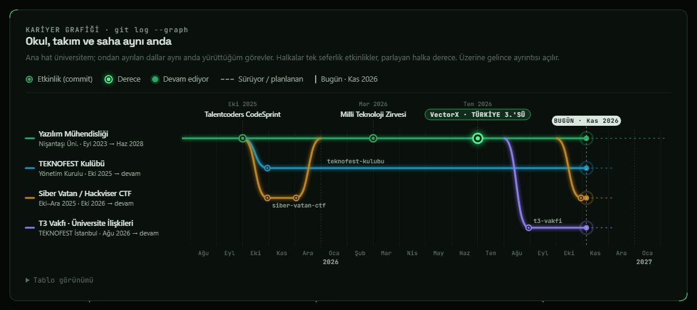
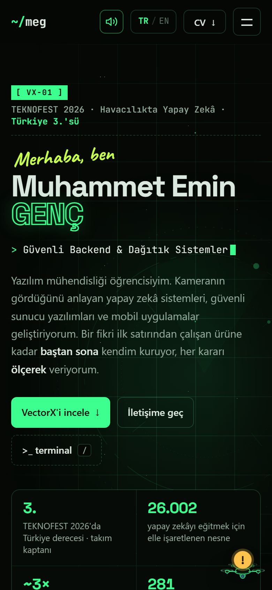
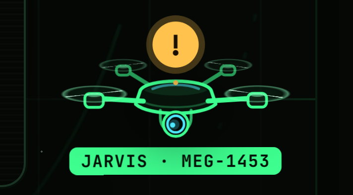

<div align="center">

<a href="https://meg-1453.github.io/"></a>

# Muhammet Emin Genç

**Yazılım Mühendisliği Öğrencisi · Yapay Zekâ & Bilgisayarlı Görü · Güvenli Backend**

VectorX takım kaptanı — TEKNOFEST 2026 Havacılıkta Yapay Zekâ Yarışması **Türkiye 3.'sü**

[](https://meg-1453.github.io/)
[](https://meg-1453.github.io/#vectorx)
[](#teknik-yaklaşım)
[](https://meg-1453.github.io/)

### [→ Siteyi aç: meg-1453.github.io](https://meg-1453.github.io/)

</div>

---

## Bu site ne anlatıyor?

Kameranın gördüğünü anlayan yapay zekâ sistemleri, güvenli sunucu yazılımları ve mobil uygulamalar geliştiriyorum.
Bu site; yaptığım işleri yazılımcı olmayan biri için de anlaşılır, yazılımcı için de detaylı olacak şekilde anlatan
kişisel portfolyom. Her bölümde önce **"Kısaca"** özeti, istersen altında teknik ayrıntılar var.

## Öne çıkanlar

| | |
|---|---|
| **Türkiye 3.'sü** | TEKNOFEST 2026 Havacılıkta Yapay Zekâ Yarışması — 5 kişilik VectorX takımının kaptanı |
| **0,30 → 0,87** | Yarışma boyunca nesne bulma isabeti (mAP@0.5) neredeyse üç katına çıktı |
| **26.002** | Yapay zekâyı eğitmek için ekipçe elle işaretlenen nesne (5.577 kare) |
| **8×** | Araştırma kodu DPVO'yu yeni nesil ekran kartına taşıyarak elde edilen hızlanma |
| **281** | Kendi mesajlaşma uygulamam MT-29 Chat'te her sürümde çalışan otomatik güvenlik kontrolü |

## Sitede neler var?

<table>
<tr>
<td width="50%" valign="top"><br><sub><b>Sinematik açılış</b> — Linux açılışı, simüle edilmiş bir "sızma" ve kırmızı alarmda <i>Portfolyoma Hoş Geldiniz</i>. Tamamen gösteri: hiçbir veri dışarı çıkmaz.</sub></td>
<td width="50%" valign="top"><br><sub><b>VectorX</b> — Türkiye 3.'sü olan drone yapay zekâsı: herkes için kısa özet, demo videosu, grafikler ve modelin gerçek çıktıları.</sub></td>
</tr>
<tr>
<td width="50%" valign="top"><br><sub><b>Güvenlik</b> — kendi uygulamama saldırgan gözüyle yaptığım denetim, kapattığım açıklar ve 281 otomatik kontrol.</sub></td>
<td width="50%" valign="top"><br><sub><b>Kariyer git grafiği</b> — ana hat üniversite, dallar aynı anda yürüttüğüm görevler; ekrana gelince soldan "bugün"e doğru çiziliyor.</sub></td>
</tr>
</table>

- **Agent Build** — sayfa ilk açıldığında imleç "agentları" bölümleri işaretleyip kopyalayarak sayfayı gözünün önünde kuruyor.
- **JARVIS** — sayfanın kenarlarında süzülen küçük bir drone. Kamerası imlecini takip ediyor; söyleyecek bir şeyi olduğunda üstünde **"!"** beliriyor, tıklayınca o bölümü anlatıyor ya da 60 saniyelik tura çıkarıyor. Yazıların önüne geçmiyor.
- **Çalışan bir terminal** — ana sayfadaki terminale yazı yazılabiliyor; sorularını internete bağlanmadan cevaplıyor.
- **El yazısı notlar, harf harf yazılan başlıklar, iki satırlı telemetri şeridi** ve tarayıcıda anlık üretilen ses efektleri.
- **Türkçe / İngilizce** tek tıkla.

<p align="center">
  
  &nbsp;&nbsp;&nbsp;
  
</p>

## Kısayollar

| Ne | Nasıl |
|---|---|
| Terminale geç | `/` tuşu |
| Komutları gör | terminalde `help` |
| Bana soru sor | `jarvis teknofest`, `jarvis güvenlik`, `jarvis iletişim` … |
| Portfolyoyu "tara" | `scan` |
| Ödüller | `cat awards.log` |
| CV indir | `cv tr` · `cv en` |
| Sayfayı agentlara yeniden kurdur | `build` (ya da sayfanın altındaki "yeniden inşa et") |
| Sürpriz | ↑ ↑ ↓ ↓ ← → ← → B A |
| Açılışı tekrar izle / atla | `?boot=1` · `?boot=0` |

## Teknik yaklaşım

- **Sıfır bağımlılık** — saf HTML, CSS ve JavaScript. Framework, paket ya da build adımı yok; klasör olduğu gibi yayınlanıyor.
- **Düşük donanımda da akıcı** — animasyonlar yalnızca `transform`, `opacity` ve `clip-path` kullanıyor. Cihaza göre üç kademe
  (düşük donanımda daha az agent, daha az efekt). Ekran dışındaki animasyonlar duruyor, görseller ve video ihtiyaç olunca yükleniyor.
- **Erişilebilir** — klavyeyle gezilebiliyor; "azaltılmış hareket" ayarı açıksa efektler kapanıyor. Her grafiğin bir tablo görünümü var,
  renkler renk körlüğüne karşı test edildi.
- **Gizlilik** — analiz ya da takip kodu yok. Açılıştaki "sızma" gösterisi ziyaretçinin tarayıcı bilgilerini yalnızca ekranda gösterir;
  hiçbir şey kaydedilmez, gönderilmez, kamera istenmez.
- **Kütüphanesiz grafikler**, Web Audio ile sentezlenen sesler (ses dosyası yok) ve çevrimdışı çalışan JARVIS bilgi tabanı.

## Proje yapısı

```
index.html              içerik (Türkçe metin burada)
assets/css/style.css    tema ve düzen
assets/js/fx.js         açılış, sinematik giriş, çökme → kurtarma, el yazısı ve yazım efektleri
assets/js/build.js      Agent Build: imleç agentları sayfayı kaydırdıkça inşa eder
assets/js/jarvis.js     JARVIS drone: kenarlarda gezinme, "!" notları, rehberli tur
assets/js/main.js       terminal, dil, menü, iletişim, video
assets/js/charts.js     grafikler (ilk sürüm → final, alanlar, kariyer git grafiği)
assets/js/sfx.js        Web Audio ses efektleri
assets/js/lang-en.js    İngilizce sözlük (yalnızca EN seçilince yüklenir)
assets/img · video · cv görseller, VectorX demo videosu, CV PDF'leri
```

## Yerelde çalıştırma

```bash
git clone https://github.com/MEG-1453/MEG-1453.github.io.git
cd MEG-1453.github.io
python -m http.server 8765
# → http://127.0.0.1:8765
```

<details>
<summary><b>Geliştirme notları</b></summary>

- **Yeni öğe ekleme:** bir öğeye `data-b="draw"` (kutu çiz), `"type"` (başlık yaz), `"scan"` (görsel tara) ya da `"group"`
  (ilk çocuğu çiz, diğerlerini kopyala-yapıştır) verilirse Agent Build onu kurar. Çeviri için `data-i18n="anahtar"` ekleyip
  `assets/js/lang-en.js`'e İngilizcesi yazılır.
- **Harf harf yazım:** `data-type="cmd"` ya da `data-type="code"`. **El yazısı notlar:** `data-anno` içindeki `.hand` ve `.mark`.
- **Açılış:** Linux açılışı → simüle sızma → kırmızı alarm ("Portfolyoma Hoş Geldiniz" + "Sinematik modu başlat").
  Basılırsa geri sayım, kapılar ve çökme → kurtarma oynar; 9 sn içinde basılmazsa kısa akışla siteye geçilir. Oturum başına bir kez.
- **Agent Build:** `?build=1` zorla çalıştırır, `?build=0` kapatır; Esc atlar.
- **Ses:** varsayılan açık, menüden kapatılır ve tercih hatırlanır. Tarayıcılar ilk dokunuştan önce sesi engellediği için ilk dokunuş yalnızca sesi açar.
- **Önbellek:** `index.html` içindeki CSS/JS bağlantılarında `?v=…` sürüm etiketi var; dosyalar değişince bu değer güncellenmeli.

</details>

## İletişim

| | |
|---|---|
| E-posta | [muhammetemingenc679@gmail.com](mailto:muhammetemingenc679@gmail.com) |
| WhatsApp | [+90 533 563 52 29](https://wa.me/905335635229) |
| LinkedIn | [muhammet-emin-genç](https://www.linkedin.com/in/muhammet-emin-gen%C3%A7-a6797a38b/) |
| GitHub | [@MEG-1453](https://github.com/MEG-1453) |
| Konum | İstanbul, Türkiye |

Çalışmalarımı beğendiysen siteden bir kahve ısmarlayabilir ya da bu depoya bir ⭐ bırakabilirsin.

---

### English

Personal portfolio of **Muhammet Emin Genç**, software engineering student and captain of team VectorX —
**3rd in Türkiye** at the TEKNOFEST 2026 AI in Aviation competition. The site explains computer-vision, secure-backend
and mobile projects in plain language first, with technical depth underneath. It is built with plain HTML, CSS and
JavaScript — no frameworks, no dependencies, no build step — and stays smooth on low-end devices.
Highlights: a cinematic boot intro, cursor "agents" that build the page, a JARVIS drone guide, a working terminal,
an animated career git graph and a full Turkish / English switch. **Live:** [meg-1453.github.io](https://meg-1453.github.io/)

<sub>© 2026 Muhammet Emin Genç — tüm hakları saklıdır. İçerik, görseller ve kod izin alınmadan kopyalanamaz.</sub>
